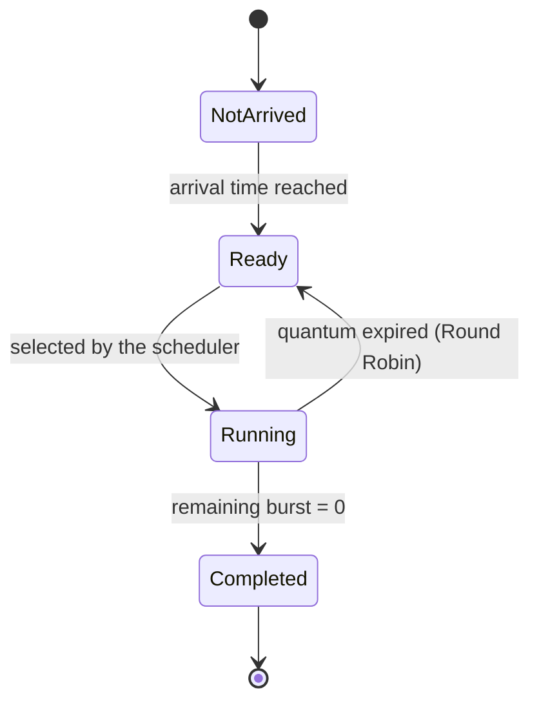
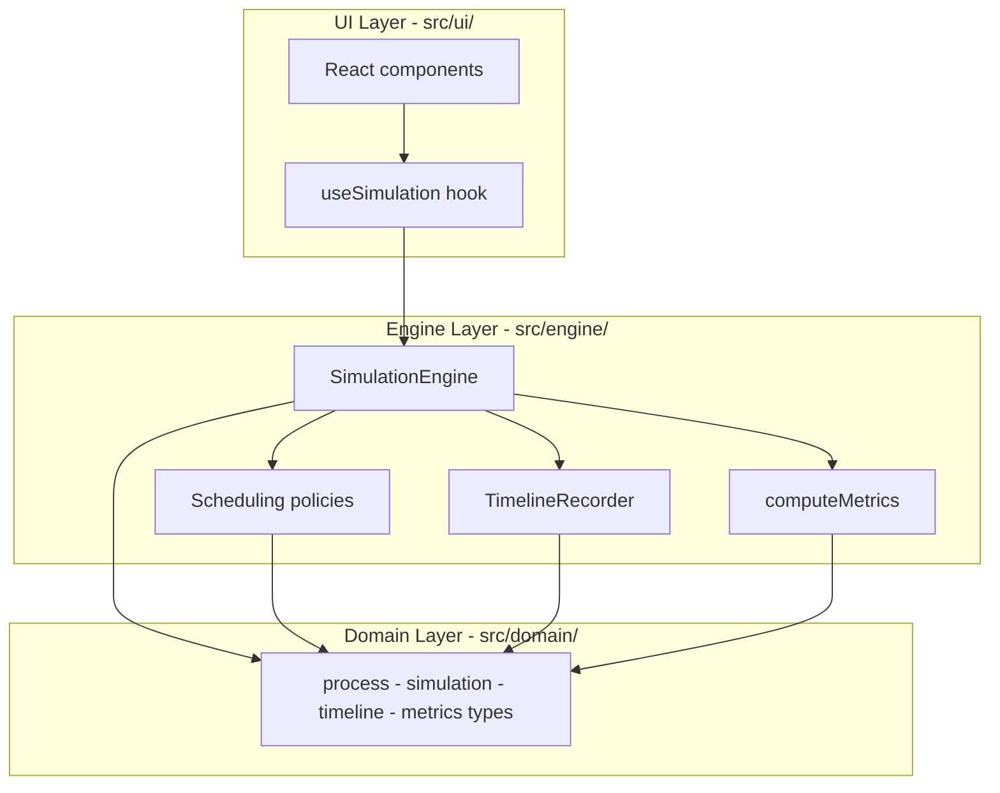
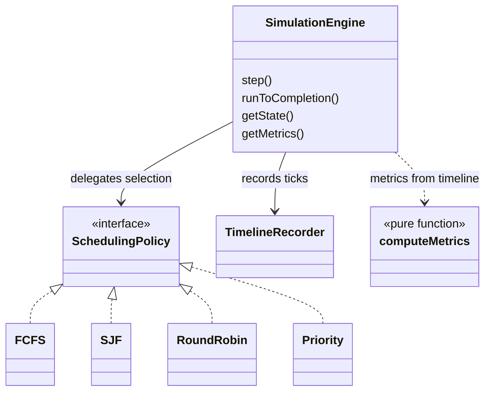
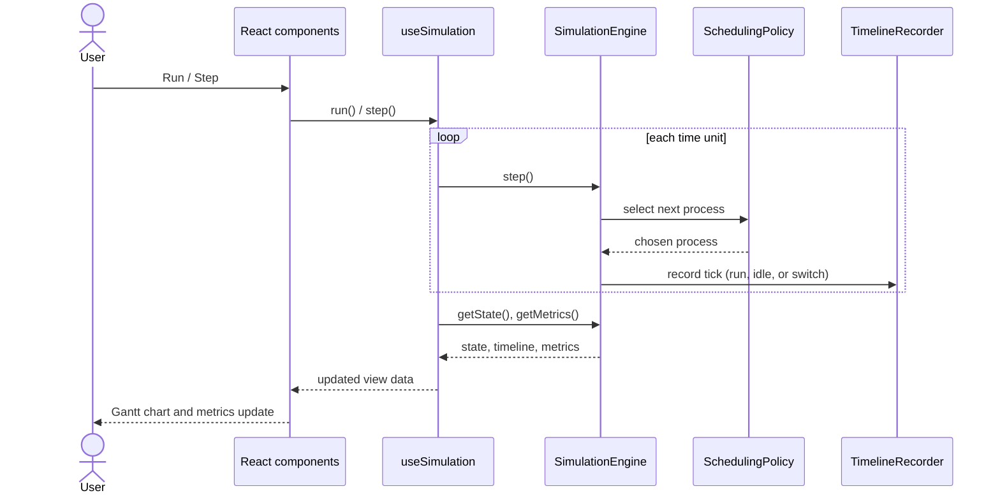
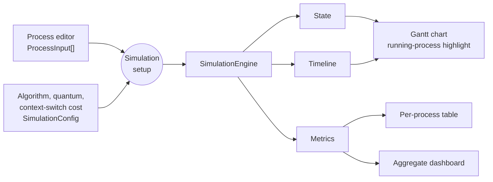
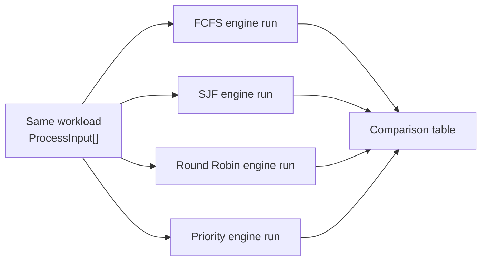
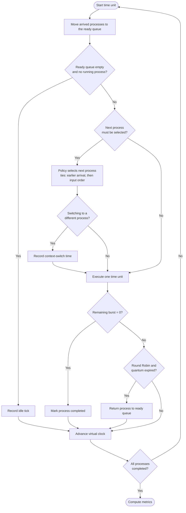
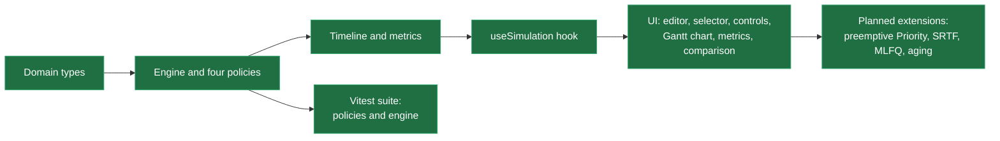
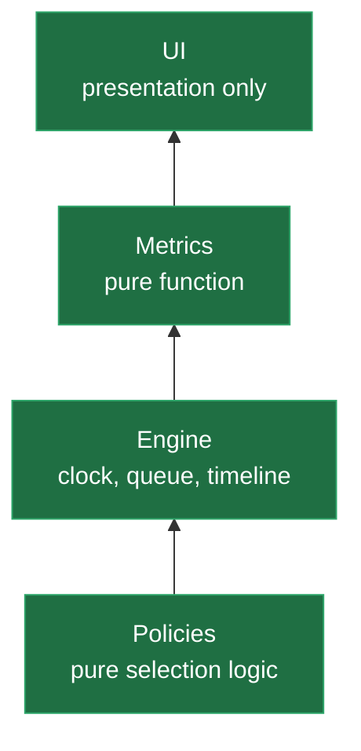

# CPU Process Scheduling Simulator

A web-based educational application that simulates CPU scheduling algorithms, visualizes execution as Gantt charts, and compares algorithm performance on the same workload.

> Developed by Ahmed Medhat. Researched and documented by Daniel Emad and Kareem Majed.

## Overview
The simulator is intended for operating systems students and instructors. A user defines a set of processes, selects a scheduling algorithm, and runs the simulation step by step or to completion. The application shows which process holds the CPU at each time unit and reports the resulting performance metrics.

Scheduling decisions are difficult to evaluate from definitions alone, because the effect of an algorithm depends on the workload. The simulator removes that difficulty by running the same workload through each algorithm and presenting the timelines and metrics side by side. It models scheduling with a virtual clock and does not execute real operating-system processes. It runs entirely in the browser, with no backend and no database.

## Operating Systems Background
A single CPU core can execute only one process at a time, while many processes may be ready to run. The CPU scheduler decides which ready process receives the CPU next. In this simulator a process moves through four states: it is **not yet arrived** until its arrival time, **ready** while it waits in the ready queue, **running** while it holds the CPU, and **completed** when its burst is finished. Input and output waiting is not modeled, so each process has a single CPU burst.



A scheduling algorithm is **non-preemptive** if a running process keeps the CPU until it finishes, and **preemptive** if the scheduler may take the CPU away before then. Four algorithms are implemented. First Come, First Served (FCFS) runs processes in arrival order; it is simple, but a long process at the front delays every process behind it. Shortest Job First (SJF) runs the available process with the shortest burst, which minimizes average waiting time for non-preemptive scheduling but can delay long processes. Round Robin gives each process the CPU for at most one time quantum and then returns it to the end of the ready queue, which improves response time at the cost of more switches. Priority scheduling runs the available process with the highest priority, where a lower number means higher priority, and can delay low-priority processes.

Changing the running process is a **context switch**. In a real system the switch costs time because process state must be saved and restored, and no user work is done during it. The simulator models this cost as a configurable number of time units, which makes the overhead of preemptive scheduling visible.

| Metric | Definition | Meaning |
|---|---|---|
| Waiting time | Time spent in the ready queue | How long a process is delayed |
| Turnaround time | Completion time − arrival time | Total time from arrival to finish |
| Response time | First CPU start − arrival time | How soon a process first runs |
| CPU utilization | Useful execution time ÷ elapsed time | Share of time spent on process work |
| Throughput | Completed processes ÷ elapsed time | Rate of completion |
| Context switches | Number of CPU context transitions | Scheduling overhead |

## Features
| Area | Capability |
|---|---|
| Workload | Add, edit, and delete processes (arrival time, burst time, priority) with input validation |
| Configuration | Algorithm selector, time quantum input (Round Robin only), context-switch cost input |
| Execution | Run, pause, step, and reset controls; speed control (slow, normal, fast) |
| Visualization | Gantt chart with time axis and highlighting of the running process |
| Metrics | Per-process metrics table and aggregate metrics dashboard |
| Comparison | Table that runs all four algorithms on the same workload |

## Architecture
The project has three layers. Dependencies point downward only: the UI may use the engine and the domain, the engine may use the domain, and the domain uses nothing.

```ts
+--------------------------------------------------------+
| UI          src/ui/                                    |
| React components, useSimulation hook                   |
+---------------------------+----------------------------+
                            | depends on
+---------------------------v----------------------------+
| Engine      src/engine/                                |
| SimulationEngine, scheduling policies, timeline,       |
| metrics                                                |
+---------------------------+----------------------------+
                            | depends on
+---------------------------v----------------------------+
| Domain      src/domain/                                |
| Pure TypeScript types                                  |
+--------------------------------------------------------+
```

| Layer | Why it exists | May not depend on |
|---|---|---|
| Domain | Gives every layer one shared definition of processes, simulation state, timeline segments, and metrics. Contains types only, with no logic. | Engine, UI, React, any external package |
| Engine | Holds all scheduling logic as pure TypeScript so it can be tested without a browser and reused without React. | UI, React |
| UI | Presents state and collects input. The `useSimulation` hook owns an engine instance and exposes run, pause, step, and reset to components. | Scheduling logic; scheduling decisions are never made in this layer |

The engine accepts a `ProcessInput[]` and a `SimulationConfig` and exposes the following interface.

| Method | Purpose |
|---|---|
| `step()` | Advance the simulation by one time unit |
| `runToCompletion()` | Run until all processes are completed |
| `getState()` | Return the current simulation state |
| `getMetrics()` | Return per-process and aggregate metrics |

Each scheduling algorithm implements a common `SchedulingPolicy` interface, so the engine selects the next process without knowing which algorithm is active.

### Layer Dependencies


### Engine Components


### Runtime Interaction


### Data Flow


### Algorithm Comparison Flow


## Project Structure
```bash
.
├── src/
│   ├── domain/
│   │   ├── process.ts
│   │   ├── simulation.ts
│   │   ├── timeline.ts
│   │   └── metrics.ts
│   ├── engine/
│   │   ├── SimulationEngine.ts        # state machine: step, run, state, metrics
│   │   ├── policies/
│   │   │   ├── SchedulingPolicy.ts    # policy interface
│   │   │   ├── fcfs.ts
│   │   │   ├── sjf.ts
│   │   │   ├── roundRobin.ts
│   │   │   └── priority.ts
│   │   ├── timeline/
│   │   │   └── TimelineRecorder.ts    # merges adjacent ticks into Gantt segments
│   │   └── metrics/
│   │       └── computeMetrics.ts      # pure metrics function
│   └── ui/
│       ├── useSimulation.ts           # hook that owns the engine instance
│       └── ...                        # components: editor, controls, Gantt chart, metrics
├── index.html
├── package.json
├── tsconfig.json
└── vite.config.ts
```

## Scheduling Rules
| Rule | Behavior |
|---|---|
| CPU model | Single core; one CPU burst per process |
| Time | Integer time units only; no fractional values |
| Tie-breaking | Ties on the algorithm's selection key are resolved by earlier arrival, then by input order |
| Priority | Lower numerical value means higher priority |
| Preemption | Only Round Robin is preemptive, after the configured time quantum; FCFS, SJF, and Priority are non-preemptive |
| Idle CPU | When no process is ready, the CPU is idle and each idle tick is recorded in the timeline |
| Context switch | Cost is configurable in time units, is shown as its own segment in the timeline, and counts as non-useful time |
| Metrics | Computed from the finished timeline; context-switch and idle time are excluded from useful execution time |



## Tech Stack
| Technology | Purpose | Justification |
|---|---|---|
| React | UI library | Component model suits a state-driven view that re-renders on each simulation step |
| TypeScript | Language | Static types make the domain model explicit and catch errors in the engine before runtime |
| Vite | Build tool and dev server | Fast startup and a minimal configuration for a client-only application |
| Bootstrap 5 | Layout and components | Provides responsive layout, tables, and form controls without custom CSS frameworks |
| Bootstrap Icons | Icons | Matches Bootstrap and avoids a separate icon system |
| Vitest | Test framework | Integrates with Vite configuration and runs TypeScript tests directly |
| Git and GitHub | Version control | Change history and collaboration among the team members |

## Getting Started
Node.js and npm must be installed.

```bash
git clone <repository-url>
cd <repository-folder>
npm install
npm run dev
npm run test
```

`npm run dev` starts the development server and prints the local address (the Vite default is `http://localhost:5173`). `npm run test` runs the Vitest suite.

## Available Scripts
| Script | Purpose |
|---|---|
| `npm run dev` | Start the Vite development server |
| `npm run build` | Type-check and create a production build |
| `npm run preview` | Serve the production build locally |
| `npm run test` | Run the Vitest suite |

## Implementation Status
| Component | Status |
|---|---|
| Domain types | Complete |
| Engine with FCFS, SJF, Round Robin, and Priority | Complete |
| Timeline recorder and metrics computation | Complete |
| `useSimulation` hook | Complete |
| Process editor with validation | Complete |
| Algorithm selector, time quantum, and context-switch cost inputs | Complete |
| Run, pause, step, reset, and speed controls | Complete |
| Gantt chart with time axis and running-process highlight | Complete |
| Per-process metrics table and aggregate dashboard | Complete |
| Algorithm comparison table | Complete |
| Vitest suite for policies and engine | Complete |
| Extensions: preemptive Priority, SRTF, MLFQ, priority aging | Planned |



Green nodes are complete; the grey node is planned.

## Testing Strategy
Tests are written with Vitest. The scheduling logic is pure TypeScript with no dependency on React, so tests call it directly with fixed inputs and compare the output to expected results. The same input always produces the same output, which makes the expected values checkable by hand.

| Layer | What is tested | Why |
|---|---|---|
| Policies | Next-process selection for each algorithm, including tie-breaking and Round Robin rotation | Each algorithm is the part most likely to contain subtle ordering errors |
| Engine | Step and run behavior, arrival handling, idle periods, context-switch cost, completion, single-process and equal-arrival workloads | The engine combines policies, the clock, and the timeline, so interaction errors appear here |
| Metrics | `computeMetrics` is a pure function of the finished simulation and can be tested with fixed timelines | Metric definitions must match the formulas in this document; a dedicated suite is not listed in the current status |
| UI | Not covered by automated tests | Behavior of the UI is limited to presentation, because scheduling decisions are made in the engine |



## Design Decisions
| Decision | Reasoning |
|---|---|
| Integer time units | Keeps the clock exact, avoids floating-point rounding in metrics, and makes expected values easy to verify by hand |
| Single core, one burst per process | Isolates the scheduling decision; multi-core and I/O blocking would add concerns unrelated to the algorithms studied |
| Policy interface | Each algorithm is a separate implementation behind one interface, so adding an algorithm does not change the engine |
| Only Round Robin is preemptive | The four required algorithms are defined as non-preemptive except Round Robin; preemptive variants are listed as future work |
| Context switch counted as non-useful time | Reflects real cost: the CPU is busy but no process makes progress, so utilization decreases as overhead increases |
| Tie-break by arrival, then input order | Gives a deterministic result for equal keys, so identical workloads always produce identical timelines |
| Idle ticks recorded | Makes gaps between arrivals visible in the Gantt chart and keeps elapsed time consistent in utilization and throughput |
| Engine independent of React | Allows the logic to be tested and reasoned about without rendering, and keeps the UI replaceable |

## License
This project was developed as university coursework. All rights reserved by the authors. No part may be reproduced or distributed without their written permission.