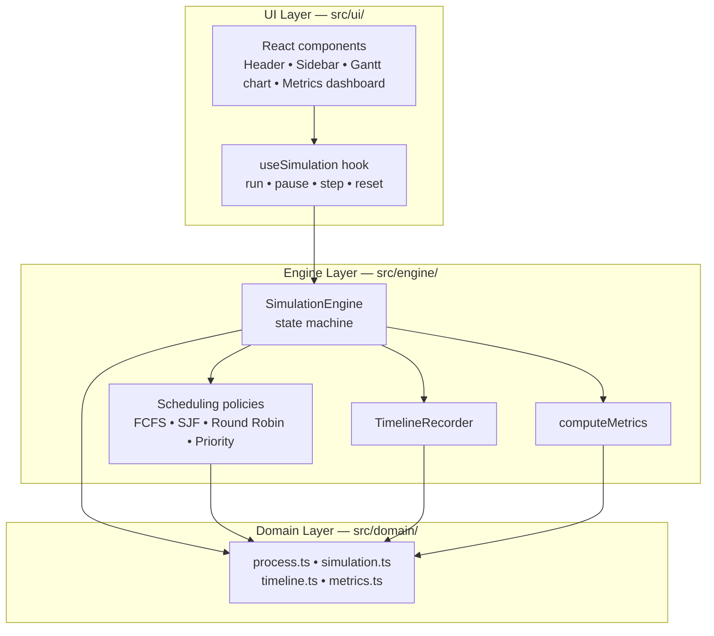
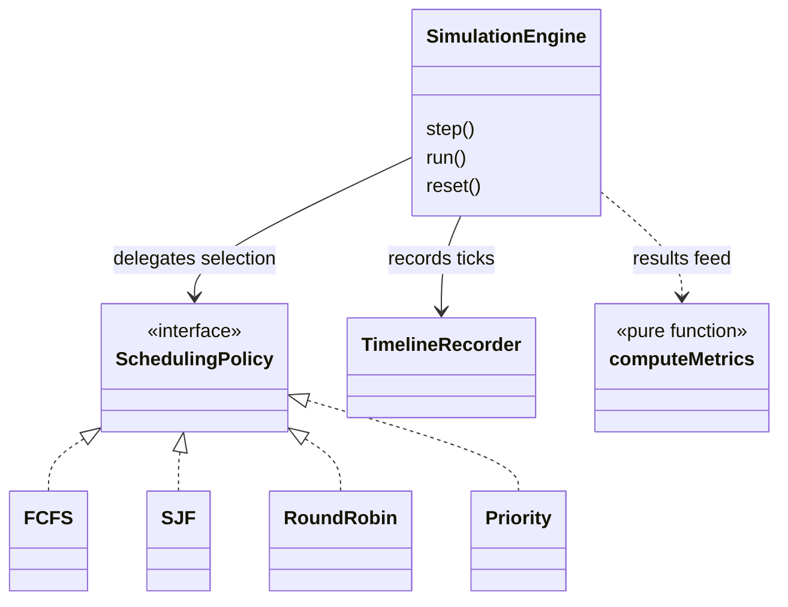
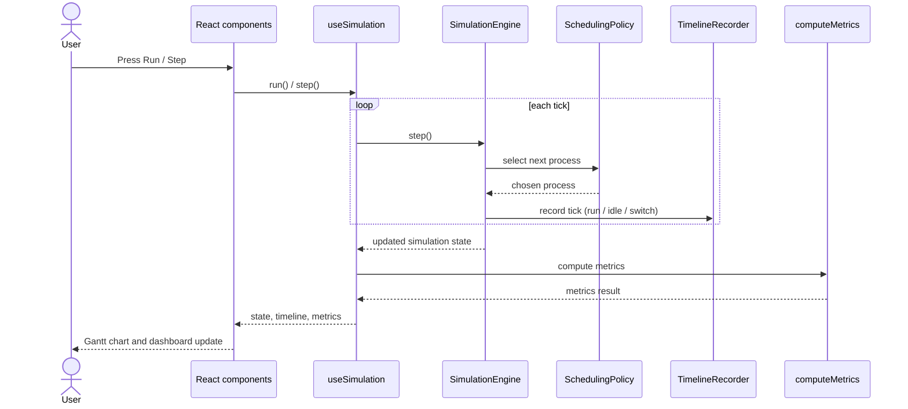
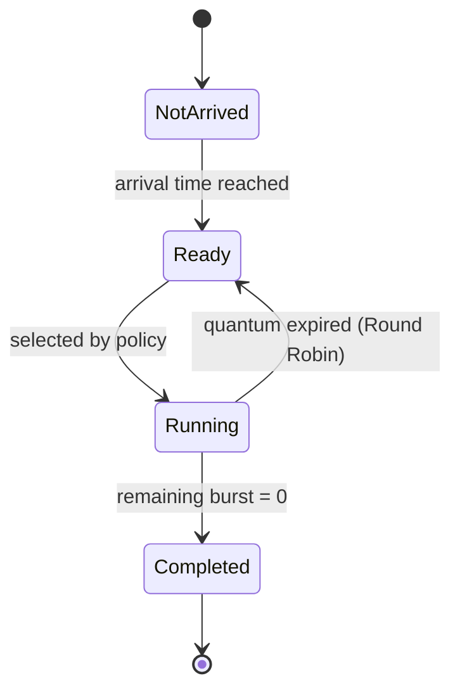
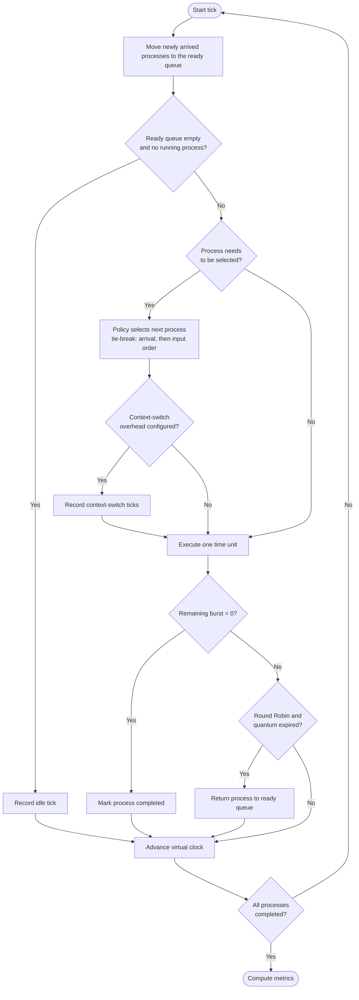

# CPU Process Scheduling Simulator
A web-based educational application that simulates CPU scheduling algorithms, visualizes execution as Gantt charts, and compares algorithm performance on the same workload.
 
> Developed by **Ahmed Medhat**
> Researched/Documented by **Daniel Emad** & **Kareem Majed**
 
---
## Table of Contents
- [Overview](#overview)
- [Features](#features)
- [Technology Stack](#technology-stack)
- [Architecture](#architecture)
- [Project Structure](#project-structure)
- [Getting Started](#getting-started)
- [Available Scripts](#available-scripts)
- [Scheduling Rules](#scheduling-rules)
- [Performance Metrics](#performance-metrics)
- [Roadmap](#roadmap)
- [License](#license)
---
## Overview
Users define a process workload, configure scheduling parameters, run a simulation, and inspect the resulting execution timeline and metrics. The application simulates scheduling behavior with a virtual clock; it does not run real operating-system processes. It is entirely client-side, with no backend and no database.
 
## Features
- Four scheduling algorithms: FCFS, SJF, Round Robin, and Priority.
- Step-by-step and continuous simulation with run, pause, step, and reset controls.
- Gantt chart built from coalesced timeline segments (execution, idle, context switch).
- Configurable context-switch overhead and Round Robin time quantum.
- Computed metrics: waiting, turnaround, and response time, CPU utilization, throughput, and context switches.
- Dark-themed dashboard layout.
## Technology Stack
| Technology | Version | Role |
|---|---|---|
| React | `<from package.json>` | UI library |
| TypeScript | `<from package.json>` | Language |
| Vite | `<from package.json>` | Build tool and dev server |
| Bootstrap | 5.x | Layout and components |
| Bootstrap Icons | `<from package.json>` | Iconography |
| Vitest | `<from package.json>` | Test framework (configuration in progress) |
| Git / GitHub | — | Version control |
 
## Architecture
The project uses a layered architecture in which dependencies point inward only: UI depends on the engine, the engine depends on the domain, and the domain depends on nothing.
 
```bash
┌──────────────────────────────────────────────┐
│ UI Layer          src/ui/                    │  React components, useSimulation hook
├──────────────────────────────────────────────┤
│ Engine Layer      src/engine/                │  Simulation engine, policies, metrics
├──────────────────────────────────────────────┤
│ Domain Layer      src/domain/                │  Pure types, no logic, no dependencies
└──────────────────────────────────────────────┘
        dependencies point downward (inward) only
```
 
| Layer | Location | Responsibility |
|---|---|---|
| **Domain** | `src/domain/` | Pure TypeScript types with zero logic and zero external dependencies: `process.ts`, `simulation.ts`, `timeline.ts`, `metrics.ts`. |
| **Engine** | `src/engine/` | Pure TypeScript simulation engine, independent of React. `SimulationEngine` is a state machine with step, run, and reset. Scheduling decisions are delegated to interchangeable policies. `TimelineRecorder` coalesces adjacent ticks into Gantt segments. `computeMetrics` is a pure function over the finished simulation. |
| **UI** | `src/ui/` | React components only. The `useSimulation` hook owns a `SimulationEngine` instance and exposes run, pause, step, and reset controls to the components. |
 
### Dependency Graph

 
### Engine Components

 
### Runtime Interaction

 
## Project Structure
```bash
.
├── src/
│   ├── domain/
│   │   ├── process.ts
│   │   ├── simulation.ts
│   │   ├── timeline.ts
│   │   └── metrics.ts
│   ├── engine/
│   │   ├── SimulationEngine.ts        # state machine: step / run / reset
│   │   ├── policies/
│   │   │   ├── SchedulingPolicy.ts    # policy interface
│   │   │   ├── fcfs.ts
│   │   │   ├── sjf.ts
│   │   │   ├── roundRobin.ts
│   │   │   └── priority.ts
│   │   ├── timeline/
│   │   │   └── TimelineRecorder.ts    # coalesces ticks into Gantt segments
│   │   └── metrics/
│   │       └── computeMetrics.ts      # pure metrics function
│   └── ui/
│       ├── useSimulation.ts           # hook wrapping SimulationEngine
│       └── ...                        # layout, Gantt chart, metrics dashboard
├── index.html
├── package.json
├── tsconfig.json
└── vite.config.ts
```
 
## Getting Started
### Prerequisites
| Tool | Notes |
|---|---|
| Node.js | Current LTS recommended |
| npm | Bundled with Node.js |
 
### Installation and Run
```bash
git clone <repository-url>
cd <repository-folder>
 
npm install
npm run dev
```
The development server prints the local URL (Vite default: `http://localhost:5173`).
 
## Available Scripts
| Script | Purpose |
|---|---|
| `npm run dev` | Start the Vite development server |
| `npm run build` | Type-check and create a production build |
| `npm run preview` | Preview the production build locally |
| `npm run test` | Run the Vitest suite (configuration in progress) |
 
## Scheduling Rules
The engine follows the behavior contract below. Policies and tests should treat it as the specification.
 
### Algorithms
| Algorithm | Type | Selection rule |
|---|---|---|
| FCFS | Non-preemptive | Earliest arrival first |
| SJF | Non-preemptive | Shortest burst among arrived processes |
| Round Robin | Preemptive | Rotate after each time quantum (configurable) |
| Priority | Non-preemptive | Lowest numerical value = highest priority |
 
### Behavior Contract
| Rule | Behavior |
|---|---|
| CPU model | Single core, one CPU burst per process |
| Time | Integer time units only; no fractional times |
| Tie-breaking | Earlier arrival wins; on equal arrival, input order wins |
| Idle CPU | When the ready queue is empty the CPU is idle; idle ticks are recorded in the timeline |
| Context switch | Overhead is configurable and is counted as non-useful time for CPU utilization |
 
### Process State Model

 
### Simulation Tick Flow

 
## Performance Metrics
| Metric | Definition |
|---|---|
| Waiting Time | Time spent in the ready queue |
| Turnaround Time | Completion time − arrival time |
| Response Time | First CPU start − arrival time |
| CPU Utilization | Useful execution time ÷ elapsed time (context switches and idle excluded) |
| Throughput | Completed processes ÷ elapsed time |
| Context Switches | Number of CPU context transitions |
 
## Roadmap
| Component | Status |
|---|---|
| Domain types | Complete |
| Simulation engine with all four policies | Complete |
| Timeline recorder with tick coalescing | Complete |
| Metrics computation | Complete |
| Dashboard shell (header, footer, sidebar, main area, dark theme) | Complete |
| Simulation hook wired to the engine (run, pause, step, reset) | Complete |
| Gantt chart component | Complete |
| Metrics dashboard | Complete |
| Process input editor | In progress (processes are currently hardcoded) |
| Algorithm selector | In progress |
| Algorithm comparison | In progress (placeholder exists, logic pending) |
| Test suite | In progress (configuration underway) |
 
### Progress Overview

```mermaid
flowchart LR
    subgraph Done["Complete"]
        D1[Domain types]
        D2[Engine and four policies]
        D3[Timeline recorder]
        D4[Metrics computation]
        D5[Dashboard shell]
        D6[Simulation hook]
        D7[Gantt chart]
        D8[Metrics dashboard]
    end
    subgraph WIP["In progress"]
        W1[Process input editor]
        W2[Algorithm selector]
        W3[Algorithm comparison]
        W4[Test suite]
    end
    Done --> WIP
    style Done fill:#1f6f43,stroke:#2ea66a,color:#ffffff
    style WIP fill:#8a5a00,stroke:#d49a1a,color:#ffffff
```


Possible later extensions: preemptive Priority, SRTF, MLFQ, priority aging.
 
---
## License
**PROPRIETARY LICENSE** — © 2026 Egypt Supply Chain Visibility Team. All Rights Reserved.
This project is a university capstone project. This software and associated documentation are proprietary and confidential. No part may be reproduced, distributed, or transmitted in any form without prior written permission from the authors.