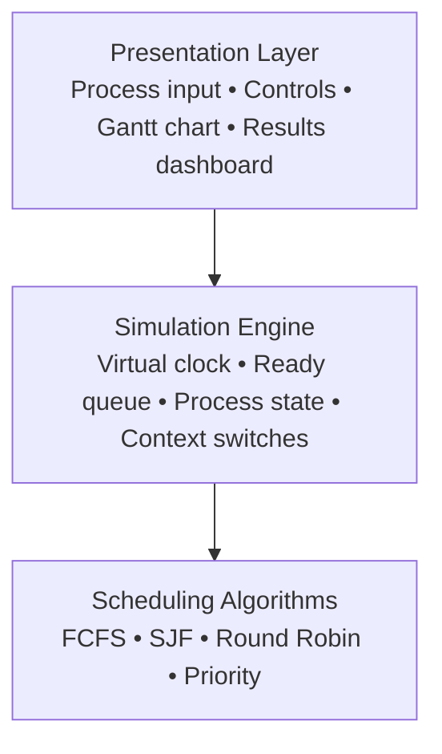

# CPU Process Scheduling Simulator

> Developed by **Ahmed Medhat**
> Researched/Documented by **Daniel Emad** & **Kareem Majed**

**Project type:** Interactive Simulation Application
**Course:** Operating Systems
**Status:** Project Proposal

---
## Table of Contents
- [Overview](#overview)
- [Problem Statement](#problem-statement)
- [What the Simulator Does](#what-the-simulator-does)
- [Project Objectives](#project-objectives)
- [Scope and Limitations](#scope-and-limitations)
- [Scheduling Algorithms](#scheduling-algorithms)
- [How the Simulation Works](#how-the-simulation-works)
- [System Architecture](#system-architecture)
- [Planned Visualization](#planned-visualization)
- [Performance Metrics](#performance-metrics)
- [Testing Plan](#testing-plan)
- [Technology Stack](#technology-stack)
- [Getting Started](#getting-started)
- [Implementation Roadmap](#implementation-roadmap)
- [Expected Outcome](#expected-outcome)
- [Future Enhancements](#future-enhancements)
- [License](#license)

---
## Overview
The CPU Process Scheduling Simulator is a software tool for visualizing and comparing CPU scheduling algorithms. Multiple processes compete for limited CPU time, and the operating system needs a strategy to decide **which process runs, when it runs, and for how long**. This project lets users define a workload, run it through different scheduling strategies, and observe the results interactively.

The application **simulates scheduling behavior using a virtual clock — it does not run actual OS processes.**

```bash
Processes                 Ready Queue                  CPU
Browser • Editor   ───►   Processes waiting   ───►   One process executes
Music • Background        for CPU allocation          at a time per core
```

## Problem Statement
Scheduling decisions directly affect system performance, but the topic is hard to grasp from theory alone:

| Challenge | Description |
|---|---|
| **Different algorithms** | Each scheduling approach makes different decisions and introduces different trade-offs. |
| **Hard to visualize** | The behavior of queues, preemption, and context switches is difficult to understand from theory alone. |
| **Hard to compare** | Waiting, turnaround, and response times vary by algorithm and workload. |

This project provides an interactive way to **simulate, observe, and compare** scheduling behavior.

## What the Simulator Does
| Step | Action | Description |
|---|---|---|
| 1 | **Create processes** | Enter arrival time, burst time, and priority. |
| 2 | **Configure** | Choose an algorithm and simulation settings. |
| 3 | **Simulate** | Observe scheduling decisions and CPU execution. |
| 4 | **Analyze** | Compare metrics and execution timelines. |

## Project Objectives
- Implement and simulate multiple CPU scheduling algorithms.
- Allow users to configure process workloads and scheduling parameters.
- Visualize process execution using a Gantt chart.
- Model context switching with configurable overhead.
- Calculate standard performance metrics.
- Compare algorithms using the same workload.
- Provide an interactive learning and experimentation environment.

## Scope and Limitations
The simulation focuses on a **single CPU core** and a **single CPU burst per process**.
| Included | Out of scope (initial version) |
|---|---|
| FCFS (First Come, First Served) | Real OS process execution |
| SJF (Shortest Job First, non-preemptive) | Multiple CPU cores |
| Round Robin (configurable time quantum) | Process I/O blocking |
| Priority Scheduling (non-preemptive) | Full operating-system implementation |
| Process arrivals and ready queue | |
| Configurable context-switch overhead | |
| Gantt chart, metrics, and comparison | |

## Scheduling Algorithms
| Algorithm | Type | Scheduling decision |
|---|---|---|
| **FCFS** | Non-preemptive | Execute in arrival / queue order |
| **SJF** | Non-preemptive | Choose the shortest available burst |
| **Round Robin** | Preemptive | Rotate after each time quantum |
| **Priority** | Non-preemptive | Choose highest priority (lower number = higher priority) |

All algorithms use the **same input workload** when comparing results.

## How the Simulation Works
The same workflow supports every scheduling algorithm:


A **virtual clock** models process execution and scheduling events, including arrivals, preemption, idle periods, and context switches.

## System Architecture
Three logical layers keep the simulator organized:



| Layer | Responsibility |
|---|---|
| **Presentation Layer** | Displays results: process input, controls, Gantt chart, and results dashboard. |
| **Simulation Engine** | Manages simulation state: virtual clock, ready queue, process states, and context switches. |
| **Scheduling Algorithms** | Make the scheduling decisions: FCFS, SJF, Round Robin, and Priority. |

## Planned Visualization
The interface centers on an interactive Gantt chart (illustrative example below):

```bash
| P1 | P2 | P3 | P1 | P2 |
0    1    2    3    4    5 ...
```

| Component | Details |
|---|---|
| **Simulation controls** | Start • Pause • Step • Reset |
| **Process states** | Ready • Running • Completed |
| **Timeline** | Execution • Idle • Context switch |

> The visualization above is a mockup. The final design will be developed during implementation.

## Performance Metrics
Per-process values and averages are calculated for every run.

| Metric | Definition |
|---|---|
| **Waiting Time** | Time spent waiting in the ready queue |
| **Turnaround Time** | Completion time − arrival time |
| **Response Time** | First CPU start − arrival time |
| **CPU Utilization** | CPU execution time ÷ elapsed time |
| **Throughput** | Completed processes ÷ elapsed time |
| **Context Switches** | Number of CPU context transitions |

## Testing Plan
| Test scenario | Validation |
|---|---|
| Single process | Correct execution and metrics |
| Same arrival time | Correct selection and tie-breaking |
| Different arrival times | Arrival handling and idle periods |
| Round Robin with small quantum | Correct rotation and remaining time |
| Equal burst / priority | Consistent tie-breaking |
| Context-switch cost | Overhead reflected in the timeline |
| Invalid input | Validation and clear error feedback |

## Technology Stack
| Layer | Technology |
|---|---|
| Presentation | _TBD_ |
| Simulation engine | _TBD_ |
| Testing | _TBD_ |

## Getting Started
```bash
git clone <repository-url>
cd cpu-process-scheduling-simulator

# install dependencies
# run the application
# run the tests
```

## Implementation Roadmap
Development proceeds in incremental milestones:
| # | Milestone | Status |
|---|---|---|
| 1 | Project setup and process model | Planned |
| 2 | Simulation engine and FCFS | Planned |
| 3 | SJF, Round Robin, and Priority | Planned |
| 4 | Gantt chart and controls | Planned |
| 5 | Metrics and comparison dashboard | Planned |
| 6 | Testing, integration, and refinement | Planned |

Team responsibilities are divided across simulation logic, testing, and visualization.

## Expected Outcome
- Interactive scheduling simulation
- Visual process execution timeline
- Correct performance metrics
- Side-by-side algorithm comparison
- A clear learning experience for understanding CPU scheduling

## Future Enhancements
- Preemptive Priority scheduling
- Shortest Remaining Time First (SRTF)
- Multi-Level Feedback Queue (MLFQ)
- Priority aging
- More detailed step-by-step visualization

## License
**PROPRIETARY LICENSE** — © 2026 CPU Process Scheduling Simulator Team. All Rights Reserved.
This project is a university capstone project. This software and associated documentation are proprietary and confidential. No part may be reproduced, distributed, or transmitted in any form without prior written permission from the authors.

---

<div align="center">
  <strong>Making CPU scheduling easier to understand through simulation and experimentation.</strong>
</div>
